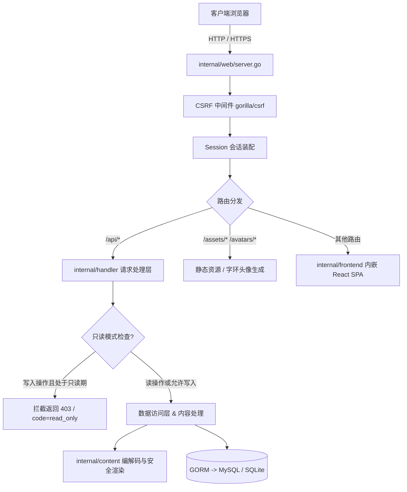
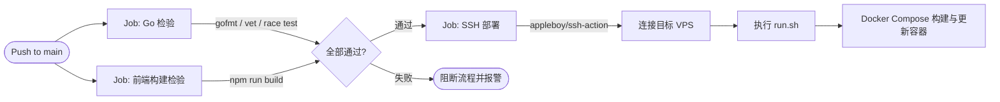
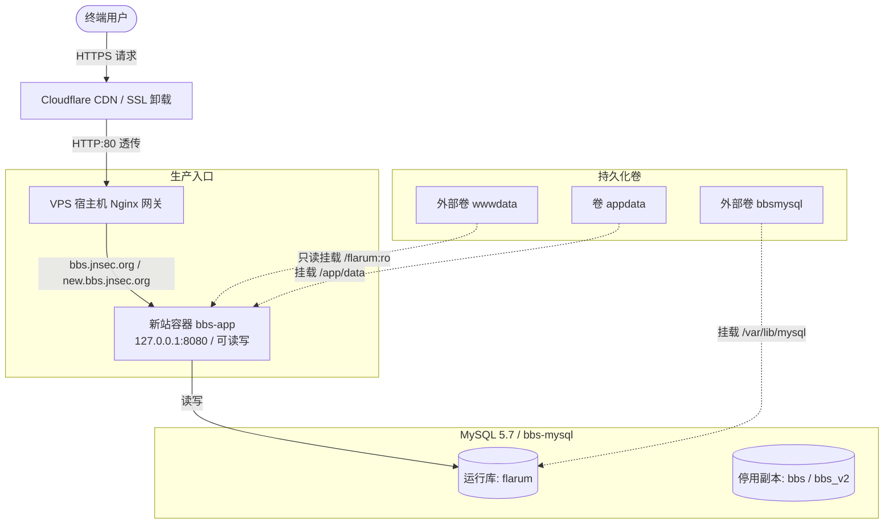

# jnsecBBS

Go + React BBS 服务，与现有 Flarum MySQL 数据库共享运行。

## 1. 技术栈 (Tech Stack)

### 后端服务 (Backend)
- **核心语言与框架**：Go 1.25+、Echo
- **数据持久化**：GORM，生产环境运行于 MySQL 5.7
- **内容解析与安全**：
  - `goldmark`：CommonMark 标准 Markdown 解析器
  - `bluemonday`：HTML 白名单净化过滤（抵御 XSS 注入）
  - `internal/content`：历史 XML / JSON 正文编解码、Markdown 安全渲染与标题路径生成
- **打包集成**：标准库 `embed.FS`，前端构建产物直接内嵌于单一 Go 二进制可执行文件。

### 前端系统 (Frontend)
- **开发与构建**：React 19、TypeScript、Vite 8；本地与 CI 支持 Bun，生产镜像使用 Node/npm
- **样式与组件**：Tailwind CSS v4、Radix UI Primitives、Lucide React 图标库、Geist Variable 字体
- **状态与缓存**：TanStack React Query v5（服务端状态与缓存）、NanoStores（轻量原子前端状态）

### 运维与基础设施 (Infra & DevOps)
- **容器与网关**：Docker、Docker Compose、Nginx
- **CDN 与证书**：Cloudflare CDN

---

## 2. 项目架构 (Project Architecture)

```
jnsecBBS/
├── cmd/                   # 服务启动入口 (serve)
├── internal/
│   ├── auth/              # 鉴权引擎 (RBAC 角色组、Session 会话、密码校验)
│   ├── config/            # 配置映射 (支持 config.yaml 与 JNSEC_* 环境变量覆盖)
│   ├── content/           # 正文编解码、Markdown 渲染、提及与标题路径
│   ├── frontend/          # embed.FS 静态产物内嵌入口 (dist/*)
│   ├── handler/           # RESTful API 路由、请求绑定、鉴权、限流与响应输出
│   ├── infra/             # 基础设施
│   │   ├── cache/         # 进程内 TTL 缓存、缓存键及失效操作
│   │   ├── db/            # MySQL / SQLite 数据库连接与历史数据一致性维护
│   │   └── mail/          # SMTP 发送、TLS 连接与邮件格式
│   ├── models/            # 数据模型定义 (兼容原 Flarum 表结构及扩展表)
│   ├── service/           # 论坛业务、可见性查询、事务、通知、资料、附件和管理操作
│   └── web/               # Echo 服务装配、CSRF、SPA、资源路由与健康检查
├── tests/                 # 后端测试按模块分目录；testdb/ 提供临时库初始化
├── frontend/              # React 19 SPA 前端工程 (源码、组件、状态与页面)
├── deploy/                # 部署配置 (Nginx 配置模板)
├── config.yaml            # 唯一应用配置，凭据由 JNSEC_* 环境变量注入
├── gar/                   # 已停用的同步、迁移和审计工具及配套文件 (仅本地保留，Git 忽略)
├── Dockerfile             # 多阶段构建文件 (Node/npm 构建前端 -> Go 编译静态二进制 -> Alpine 运行)
└── docker-compose.yaml    # 生产容器编排文件
```

容器启动时执行 `bbs serve`，连接现有数据库并启动服务，不再核对所需表清单或迁移版本。数据库结构变更由运维单独管理，部署脚本不再执行迁移。
旧的初始化、迁移和审计命令已移除，相关工具及一次性 SQL 保留在 `gar/`。

后端测试统一存放在 `tests/`，通过公开接口验证行为，执行 `go test ./...` 仍会包含全部测试。
`internal/infra/db` 负责数据库连接与论坛历史数据一致性处理，`internal/infra/cache` 提供进程内 TTL 缓存，当前未接入 Redis。
临时测试库由 `tests/testdb/` 初始化，数据库相关测试放在 `tests/infra/db/`；线上不依赖迁移记录表，也不执行初始化或表结构迁移。

`handler` 负责 HTTP 参数解析、JSON 绑定及响应输出；正文与查询规则、附件限制和存储路径由 `service` 处理；
`models` 定义数据库字段及实体自身行为，不依赖 Echo 或请求上下文。
正文编解码、渲染与标题路径生成统一在 `internal/content`；SMTP 客户端位于 `internal/infra/mail`，邮件通知业务保留在 `service/email.go`。

应用配置统一使用 `config.yaml`，镜像内路径为 `/app/config.yaml`。
配置优先级为 `JNSEC_*` 环境变量 > YAML > 程序默认值。
生产环境使用 MySQL 的 `flarum` 库和读写模式，数据库 DSN、会话密钥、SMTP 密码不写入 YAML。
`run.sh` 从部署用户的 `/home/gha_deploy/.pam_environment` 加载生产变量，写入 `.env` 并交给 Compose 注入容器；
Go 程序不会自行读取 `.env`。旧的 `config.example.yaml`、测试和本地配置已归档至 `gar/config/`。

### 核心处理链路


---

## 3. CI/CD 架构 (CI/CD Architecture)

代码仓库使用 **GitHub Actions** 自动化驱动持续集成与持续部署（CI/CD）：




### 部署关键细节
1. **测试门禁**：
   - 后端执行 `gofmt` 格式断言、`go vet` 静态排查以及 `go test -race` 竞态安全测试。
   - 前端通过 `npm ci` 安装并执行 `npm run lint` 与 `npm run build`（`tsc -b && vite build`），确保无类型及语法缺陷。
2. **安全连接**：
   - 依赖 GitHub Secrets：`VPS_HOST`、`VPS_USER`、`VPS_SSH_KEY`、`VPS_FINGERPRINT`。
3. **CD 触发策略**：
   - 为避免非生产变更频繁触发构建，CD（`deploy` Job）仅在以下两种场景执行：
     - **PR 合并到 main**：合并提交（包含 `Merge pull request`、`Merge branch` 或 PR 编号）。
     - **以 `cicd` 开头的提交**：例如 `cicd: 重新部署`、`cicd: force rebuild`。
   - 其他常规提交（如 `docs:`, `fix:`, `refactor:` 等）仅执行 CI 检查，自动跳过 CD 部署。
4. **VPS 落地触发**：
   - 经 SSH 连接后进入 `/opt/backup/refactorBBS/jnsecBBS`，触发 `run.sh` 执行 `git pull --ff-only`、配置自动同步、镜像构建与 `docker-compose up -d --no-deps app` 容器重启更新。
   - 正式部署用户 `gha_deploy` 的 SSH 密钥仅允许执行现有 `run.sh`。生产变量由服务器 PAM 在 SSH 登录时加载，优先于脚本重新生成的 `.env`；项目目录不再使用 `docker-compose.override.yml`。
   - 正式 Nginx 配置独立保存，部署用户仅获得脚本现有 Nginx 操作所需的有限免密 sudo。配置位置、原因和验收方式见 [生产部署维护](docs/production-deployment.md)。

---

## 4. 部署后架构与运行时拓扑 (Deployed Architecture)

2026-10-27 已切换为**新站直接读写 `flarum` 数据库**。当前 PHP 服务已停用，由 Go 与 MySQL 提供服务；`bbs`、`bbs_v2` 保留为停用副本，两个同步任务均已停止。



### 运行特征说明
1. **正式流量**：
   - `bbs.jnsec.org` 指向 Go 论坛，`JNSEC_READ_ONLY=false`，使用专用账号对 `flarum` 执行查询及业务写入。
   - PHP 服务已在 Compose 中注释停用，Go 直接提供论坛页面、头像和附件。
   - Nginx 同时接受 `new.bbs.jnsec.org`，但切换验收时该域名未能解析，正式入口以 `bbs.jnsec.org` 为准。
2. **数据与同步状态**：
   - Go 使用原 Flarum 表及显式迁移建立的 Go 辅助表；`bbs_v2` 的原生结构尚未接入在线 API。
   - `jnsec-bbs-sync.timer`、`jnsec-bbs-native-sync.timer` 均已禁用，对应服务已停止。共享模式无需同步，也不删除停用副本。
3. **资源持久化**：
   - `bbsmysql` 保存 MySQL 数据；Go 只读挂载 `wwwdata` 至 `/flarum:ro`，通过 `/assets` 提供历史头像和附件，资源读取不依赖 PHP 进程。
   - `appdata` 挂载至 `/app/data`，保存 Go 新上传的头像和附件。旧 PHP 日志卷 `bbslog` 不再由当前 Compose 声明。

---

### 生产同步任务维护
```bash
# 共享库模式下两个定时器应为 disabled，对应服务应为 inactive
sudo systemctl is-enabled jnsec-bbs-sync.timer jnsec-bbs-native-sync.timer
sudo systemctl is-active jnsec-bbs-sync.service jnsec-bbs-native-sync.service
# 查看最近 20 条同步执行日志
sudo journalctl -u jnsec-bbs-sync.service -n 20 --no-pager
```

`is-enabled` / `is-active` 对禁用或停止状态返回非零退出码，这是上述检查的预期结果。
重新引入镜像同步或切换运行库前，需单独制定数据切换方案。

