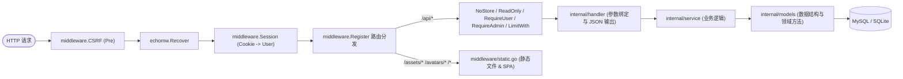

# jnsecBBS

Go + React 构建的论坛服务，使用 Flarum MySQL 数据库；前端构建产物通过 `embed.FS` 内嵌进单一 Go 二进制中。

---

## 0. 注意事项
1. 尽量不要使用 ssh vps 来部署服务，因为使用了某个特定用户去部署这些，有一些环境变量只在当前用户态下。
2. AI 提交代码前先审一下，尽量清理一下 ai slop 做的过度封装等问题，当前代码还没清理完，我整理了项目结构，职责边界（后端，前端没看），应该还有很多地方没有做完，如果有更好的写法更新已有功能，直接提交 pr 即可。

## 1. 技术栈

- **后端**：Go 1.25+、Echo v4、GORM MySQL 5.7 、`gorilla/csrf`、`goldmark` + `bluemonday`
- **前端**：React 19、TypeScript、Vite 8、Tailwind CSS v4、Radix UI、TanStack React Query、NanoStores
- **基础设施**：Docker / Docker Compose、Nginx、GitHub Actions

---

## 2. 当前项目结构

```text
jnsecBBS-deploy/
├── cmd/
│   └── main.go                  # 程序入口：加载配置、初始化 DB 与目录、挂载中间件并启动 Echo 服务
├── internal/
│   ├── config/                  # config.yaml 解析与 JNSEC_* 环境变量覆盖
│   ├── frontend/                # embed.FS 内嵌 frontend 构建产物 (dist/*)
│   ├── handler/
│   │   └── handler.go           # HTTP 层：请求绑定、Cookie 写入、调用 service、JSON 响应
│   ├── middleware/
│   │   ├── middleware.go        # 全局/路由中间件：CSRF、Session、NoStore、ReadOnly、鉴权、IP 限流
│   │   ├── router.go            # 路由注册：/api/health、/api/*、静态资源
│   │   └── static.go            # 静态目录 (/assets/*, /avatars/*)、SVG 头像、验证码图片与 SPA 兜底
│   ├── service/                 # 业务
│   │   ├── service.go           # Service 核心结构与错误定义 (Error / Err)
│   │   ├── health.go            # 数据库健康检查
│   │   ├── util.go              # 辅助函数
│   │   ├── account.go           # 账号、登录、注册、资料/密码/头像、通知与 UserDTO
│   │   ├── session.go           # Session token 生成、数据库读取与销毁
│   │   ├── discussion.go        # 首页、列表、版块、详情分页、发帖/回帖、版主操作、搜索与分页
│   │   ├── post.go              # 楼层编辑、点赞、正文实时渲染与 PostDTO
│   │   ├── files.go             # 附件上传与下载处理
│   │   ├── email.go             # 邮件服务，
│   │   └── adminops.go          # 管理后台：版块、用户组/封禁、邀请码、站点设置
│   ├── models/                  # 业务维护的数据类型，请求类型; 实现与数据库交互的方法
│   ├── util/
│   │   ├── markdown.go          # Markdown 安全渲染、解析
│   │   └── slug.go              # 标题转 URL slug
│   └── infra/
│       ├── db/                  # MySQL / SQLite 连接与启动期数据清理
│       └── mail/                # SMTP 邮件配置端
├── frontend/
│   └── src/
│       ├── main.tsx             # 前端入口
│       ├── App.tsx              # 路由与全局 Provider
│       ├── pages/               # 页面视图
│       ├── components/          # UI 与业务组件
│       └── lib/                 # API 客户端、状态与工具函数
├── deploy/                      # Nginx 反向代理配置文件
├── tests/                       # 测试
├── config.yaml                  # 应用基础配置
├── Dockerfile                   # 多阶段镜像构建 (Node 构建前端 -> Go 编译二进制 -> Alpine 运行)
├── docker-compose.yaml          # MySQL + Go 应用容器编排
└── run.sh                       # VPS 服务部署脚本
```

### 请求流转链路



---

## 3. 部署方法

### 3.1 配置说明
配置加载优先级：**`JNSEC_*` 环境变量 > `config.yaml` > 代码默认值**。  
敏感凭据（`JNSEC_DB_DSN`、`JNSEC_SESSION_SECRET`、`JNSEC_SMTP_PASSWORD`）严禁明文提交到 `config.yaml`，应由环境变量注入。

### 3.2 生产环境部署（Docker Compose + `run.sh`）

`Dockerfile` 采用多阶段构建：先用 Node 22 构建前端到 `internal/frontend/dist`，再用 Go 1.25 编译静态二进制 `/app/bbs`，最终运行在 Alpine 镜像中并监听 `8080` 端口。

`docker-compose.yaml` 编排了两个核心服务：
- `mysql`（`mysql:5.7`）：挂载外部卷 `bbsmysql`。
- `app`（`bbs-app`）：挂载 `appdata`（保存新上传头像与附件到 `/app/data`）与只读外部卷 `wwwdata`（`/flarum:ro`，兼容历史附件与头像）。

VPS 上通过 `./run.sh` 自动完成部署：
1. `git pull --ff-only origin main` 拉取最新主分支代码。
2. 同步 `.env`（若存在 `/home/gha_deploy/.pam_environment` 则优先注入生产变量）。
3. 对比 `deploy/nginx.conf.example` 与 `/etc/nginx/sites-available/bbs.jnsec.org`，有变更则 `nginx -t` 并重载 Nginx。
4. 执行 `docker-compose build app && docker-compose up -d --no-deps app` 滚动更新应用容器并清理悬空镜像。

---

## 4. 如何提交 PR (Pull Request)

仓库配置了 GitHub Actions（[.github/workflows/ci.yml](.github/workflows/ci.yml)），需要触发自动部署时在 commit message 标题或正文备注中包含 `cicd`（不区分大小写）即可。

### 提交前本地检查清单
1. **后端格式与检查**：
   ```bash
   gofmt -w .
   go vet ./...
   go test -race -count=1 ./...
   ```
2. **前端检查与构建**：
   ```bash
   cd frontend
   npm run lint
   npm run build
   ```

---

## 5. 快速熟悉项目

1. **看启动入口与装配**：先读 [cmd/main.go](cmd/main.go)，了解配置加载、数据目录初始化、邮件后台任务启动，以及 `Echo` 挂载中间件和路由的顺序。
2. **看中间件与全站路由表**：读 [internal/middleware/middleware.go](internal/middleware/middleware.go) 与 [internal/middleware/router.go](internal/middleware/router.go)，一屏掌握全站所有 API 路径、限流点及鉴权边界；静态资源与 SPA 托管在 [internal/middleware/static.go](internal/middleware/static.go)。
3. **看请求边界与数据模型**：
   - [internal/handler/handler.go](internal/handler/handler.go)：看 HTTP 参数如何绑定到 `models.*Input` 并调用 `service`。
   - [internal/models/](internal/models/)：对照了解 Flarum 兼容表结构（`User`、`Discussion`、`Post`、`Tag`、`AccessToken` 等）及实体自带行为（如 `User.CheckPassword`/`SetPassword`、`Post.Markdown`/`SetMarkdown`）。
4. **按业务域读 `internal/service/`**：
   - 登录会话个人信息：看 `account.go`（`Login`、`Register`）与 `session.go`（`StartSession`、`UserByToken`）。
   - 帖子读写：看 `discussion.go`（首页、列表、详情分页、发帖、回帖、删帖）与 `post.go`（编辑、点赞、正文实时渲染）。
   - 专项功能：按需查看 `files.go`（上传/下载）、`email.go`（邮件 Outbox）、`adminops.go`（管理后台）。
5. **看基础设施与工具**：浏览 [internal/infra/db/db.go](internal/infra/db/db.go)（数据库连接）、[internal/infra/mail/mail.go](internal/infra/mail/mail.go)（SMTP 发信）和 [internal/util/markdown.go](internal/util/markdown.go)（Markdown 消毒与 `@提及` 解析）。

